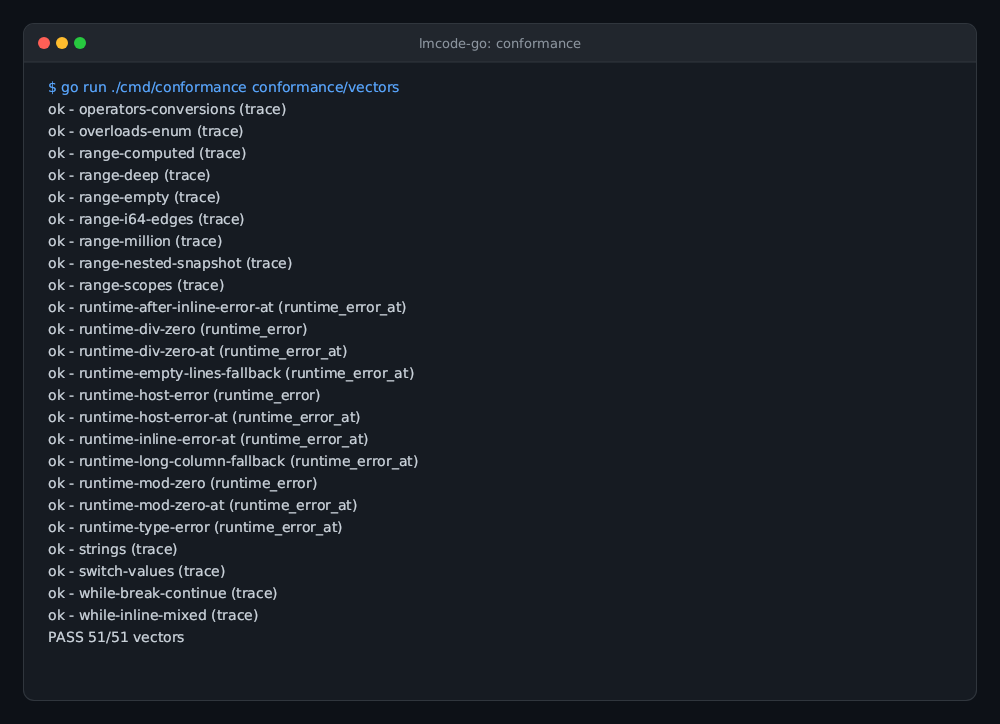
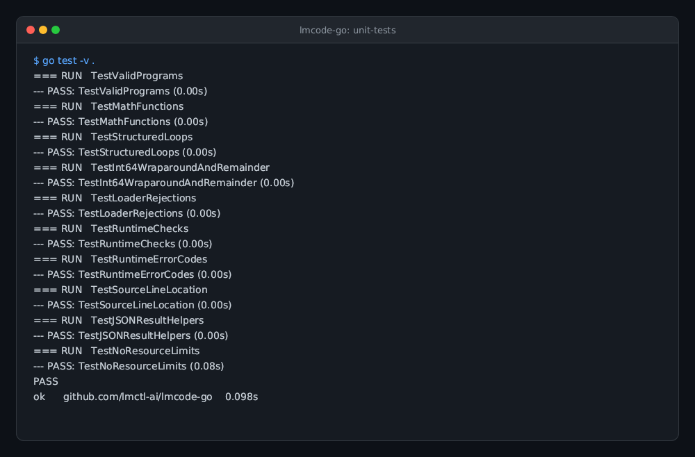
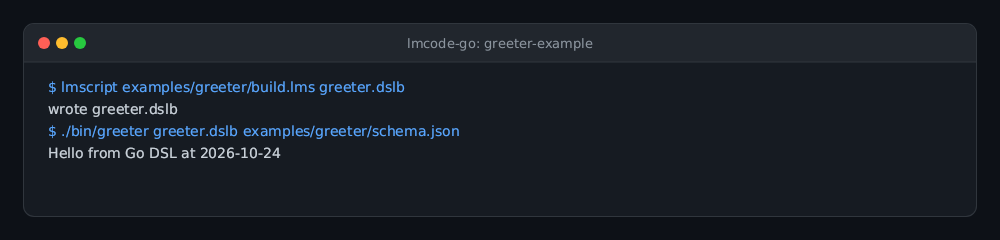
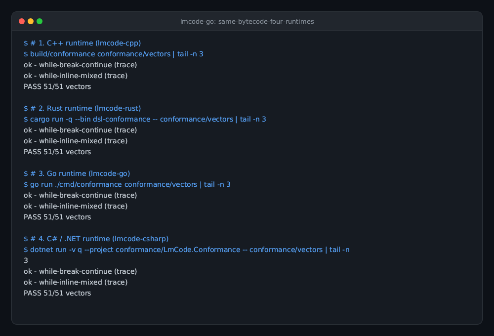

# lmcode-go

The Go runtime for lmscript `_dsl_` bytecode: loader, verifier, stack VM, and typed host registry in package `lmcode`.
Go 1.26+, standard library only, zero third-party dependencies (`go.mod` has no `require`). Builds cleanly with `CGO_ENABLED=0` into static binaries.

## Status

Experimental. The current runtime reads bytecode version 5 only; older and newer versions are refused. Use a matching
`lmscript` compiler from the published `@lmctl-ai/lmctl` npm package (or toolchain).

## What it is

lmscript compiles a `_dsl_` block (a small strongly typed configuration language whose names come from a JSON schema) into a
portable bytecode file (`.dslb`). A host program written in Go imports `github.com/lmctl-ai/lmcode-go`, implements the schema's
objects and functions in an `lmcode.Registry`, loads the file with the exact schema bytes, and runs the chunk once per event with an
`lmcode.Context` of live host objects. The host owns the process, the objects, and their lifetime; the chunk only calls what
the registry offers. lmscript never executes the DSL; this SDK never reads the schema's content, only its bytes (for the
SHA-256 binding).

## Gallery

| **Bytecode Conformance Suite** | **Unit Tests & Invariants** |
| --- | --- |
|  |  |
| All 51 core bytecode vectors pass across opcodes, types, error paths, and control flow.<br>`go run ./cmd/conformance conformance/vectors` | Unit tests covering VM type invariants, line tables, and registry semantics.<br>`go test -v .` |

| **Greeter Example Host** | **Same Bytecode, Four Runtimes** |
| --- | --- |
|  |  |
| Minimal embedding host compiling and executing DSL logic in pure Go.<br>`lmscript examples/greeter/build.lms && ./bin/greeter greeter.dslb` | Cross-language parity: C++, Rust, Go, and C# run the exact same bytecode.<br>`PASS 51/51 vectors across 4 runtimes` |

## Embedding it in twenty lines

```go
package main

import (
	"fmt"
	"os"

	"github.com/lmctl-ai/lmcode-go"
)

type Greeter struct{ last string }

func main() {
	reg := lmcode.NewRegistry()
	_ = reg.Context("g", "Greeter")
	_ = reg.Method("Greeter", "say", []string{"string"}, "void", func(self any, a []lmcode.Value) (lmcode.Value, error) {
		self.(*Greeter).last = a[0].Str
		return lmcode.None(), nil
	})
	_ = reg.Function("now", nil, "string", func(a []lmcode.Value) (lmcode.Value, error) {
		return lmcode.String("2026-10-24"), nil
	})
	if len(os.Args) > 1 && os.Args[1] == "--dsl-signatures" {
		for _, s := range reg.Signatures() { fmt.Println(s) }
		return
	}

	bc, _ := lmcode.ReadFile(os.Args[1])
	schema, _ := lmcode.ReadFile(os.Args[2])
	program, err := lmcode.Load(bc, schema, reg)
	lmcode.ExitIfError("load", err)

	greeter := &Greeter{}
	ctx := lmcode.NewContext()
	ctx.Set("g", greeter)
	err = program.Run(ctx, reg)
	lmcode.ExitIfError("run", err)
	fmt.Println(greeter.last)
}
```

`Registry` is declared with the schema's types (parameter types and return type, as strings); a name may have several overloads with distinct parameter tuples, while registering the same parameter tuple twice is refused. `Load()` resolves canonical import signatures (including parameter and return types), and refuses a file whose imports the registry does not provide, before anything runs. `reg.Signatures()` lists the sorted canonical strings (`context g: Greeter`, `fn now() -> string`, `method Greeter.say(string) -> void`), including enabled std. Compare compiler declarations with `CheckSchemaSignatures` so both host-only and std-merged schemas are accepted, while host declaration drift is rejected. That is a consistency check, not a defense: by design the VM performs no comprehensive call-time argument or return checks; it still checks method receiver kinds and other defensive VM invariants. Bytecode is trusted like the host's own code. `Value` carries `INT` (int64), `FLOAT` (binary64), `STR`, `BOOL`, and `OBJ` (host object pointer/interface plus schema type name); a void method returns `lmcode.None()`. Host code returns an error or calls `lmcode.NewHostError(msg)` to report a run-time failure.

**Result line and exit codes.** CLI hosts print exactly one JSON line on stdout through `lmcode.ReportOK(json)`, `lmcode.ReportError("load"|"run", err)` (returns 3) or `lmcode.ReportAppFailure(message)` (returns 4) and exit with the returned code; lmscript's own compile failures are exit 2. `Error.Code` is `LOAD_BAD_BYTECODE`, `LOAD_SCHEMA_MISMATCH`, `LOAD_UNBOUND`, `RUN_ERROR` (a VM error), `RUN_HOST` (returned by a host closure), or `APP_FAIL`. When a non-empty line table maps the faulting opcode, `Error` carries numeric `Line`/`Column` and prefixes the message with `dsl line N:C: `; the standard JSON result includes those fields; a zero column means the line is known and only `line` is emitted. Empty line tables preserve the original message and omit the fields.

## Versioning rule

`lmcode.Version` is the bytecode format version this SDK reads. The SDK version equals that number (currently 5) and the loader refuses every other version: there is no backward compatibility. When the compiler's format changes, the compiler, this SDK, and every host move together. Version 5 includes structured `while` and `range` loops, lexical `break` and `continue`, integer and floating-point math, typed imports, and line tables.

## What load() guarantees

Wrong magic, another version (v3 or v4 included), a schema-hash mismatch, truncation, trailing bytes, unknown constant tags, undecodable instructions, out-of-range constant/local/import/context indexes, calls whose import kind or arity differ, ordinary jumps that miss an instruction start, go backwards outside a paired `LOOP_BACK` or cross a loop boundary, malformed or misnested range/while loops, unknown MATH function IDs, writes to their read-only hidden locals, a missing HALT, and context declarations or import signatures the registry does not provide (the message names the host's own signature for that name) are refused with a message that names the problem. `Run()` checks value kinds defensively and imposes no limits: no stack cap, no locals cap, no string cap; `max_stack` from the file is a reservation hint. Integer arithmetic is 64-bit two's complement and wraps; division and remainder by zero are run-time errors.

## Standard library catalog

`NewRegistry()` installs lmcode std automatically; hosts do not need group-registration calls or handwritten std declarations. The `stdlib` package retains explicit group binders for opt-out and compatibility use. Until compiler injection lands, merge `std/lmcode-std.schema.json` into the build's compiler schema with the shared `lmcode-cpp/scripts/merge-std.py` helper and embed the exact resulting bytes. The full 16-function C++ string catalog is available: `str_len`, `str_starts_with`, `str_ends_with`, `str_contains`, `str_find`, `str_substr`, `str_lower`, `str_upper`, `str_trim`, `str_repeat`, `str_to_int`, `str_is_int`, `str_to_float`, `str_is_float`, `str_replace`, and `str_match`. Strings are raw bytes, including invalid UTF-8 and NUL; offsets are bytes and case/whitespace rules are ASCII only. Repeat and replacement preflight a 64 MiB output cap, and glob matching uses a deterministic 2^27 work cap; policy failures return `RUN_HOST`. Signature parity with the compiler is checked by
`go test ./stdlib/...` whenever `lmscript` (or `$LMSCRIPT_BIN`) is on PATH.

The built-in math catalog, also described by the compatibility fragment `stdlib/math.schema-fragment.json` provides `math_abs`, `math_min`, `math_max`, `math_floor`, `math_ceil`, `math_round`, `math_pow`, and `math_sqrt`, each with `int` and `float` overloads. Integer arithmetic wraps at int64; negative integer exponents and square roots return `RUN_HOST`. Float operations preserve IEEE NaN, infinity, and signed-zero rules, with ties-away rounding.

The collections and testing catalogs are declared in `stdlib/collections.schema-fragment.json` and `stdlib/testing.schema-fragment.json`. Default std owns its arena and clears it at run entry and exit; shared-state nested/concurrent runs are rejected. Explicit `RegisterCollections` on an opt-out registry remains a manual compatibility path with an optional `*stdlib.Collections` arena. `RegisterTesting` accepts an output writer, with nil selecting stdout.

Collection results are ordinary exported objects, so a host callback can consume a returned handle directly: `list := value.Obj.(*stdlib.StrList); snapshot := list.Values()`. Map consumers use `value.Obj.(*stdlib.StrMap).Entries()` for insertion-ordered key/value snapshots.

The root `lmcode` package owns the canonical 72-signature standard surface. `NewRegistry()` enables it, `NewRegistryWithoutStd()` opts out, and `RegisterStd` is idempotent. `StdSignatures`, `HostSignatures`, and `MatchesSchemaSignatures` expose normalized declaration checks. Exact schema bytes are pinned in `std/lmcode-std.schema.json` and `std.lock`; `stdlib` remains a compatibility forwarding package.

## Build and test

Run the entire test suite (unit tests, 51 core vectors and 61 optional catalog vectors):

```sh
go test ./...
```

Run the standalone conformance runner:

```sh
go run ./cmd/conformance ./conformance/vectors
go run ./cmd/conformance ./conformance/stdlib-vectors
```

Build the static example host:

```sh
CGO_ENABLED=0 go build -o bin/greeter ./examples/greeter
```

## Sibling runtimes

The same bytecode v5 and the same conformance vectors are implemented by:
- [lmcode-cpp](https://github.com/lmctl-ai/lmcode-cpp) (C++17 single-header reference)
- [lmcode-rust](https://github.com/lmctl-ai/lmcode-rust) (Rust crate reference)
- [lmcode-go](https://github.com/lmctl-ai/lmcode-go) (Go module)
- [lmcode-csharp](https://github.com/lmctl-ai/lmcode-csharp) (C#/.NET runtime)

## License

MIT License. Copyright (c) 2026 Lattice Systems LLC.

Built-in std has four areas: strings, math, collections, and files. `file_read`,
`file_write` (create/truncate), and `file_append` preserve every content byte.
`file_exists` is true only for regular files; missing paths and directories are
false. `file_lines` splits LF bytes into an arena-owned StrList, preserving CR
and empty fields, including the final field (`"a\n"` becomes `["a", ""]`).
Relative paths use the process cwd without sandbox restrictions; Unix passes
path bytes unchanged, while Windows requires UTF-8 paths and supports long names.
Failures trap with `RUN_HOST` and `FUNCTION: PATH: OS_REASON`.
Testing is outside std: hosts declare its separate fragment and explicitly call
`stdlib.RegisterTesting(registry, writer)` for `print`/`assert_close`.
